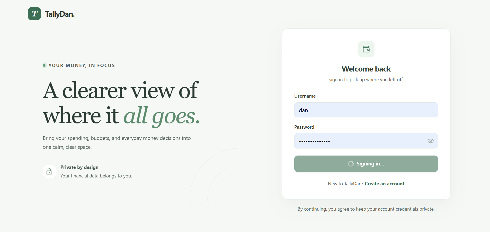
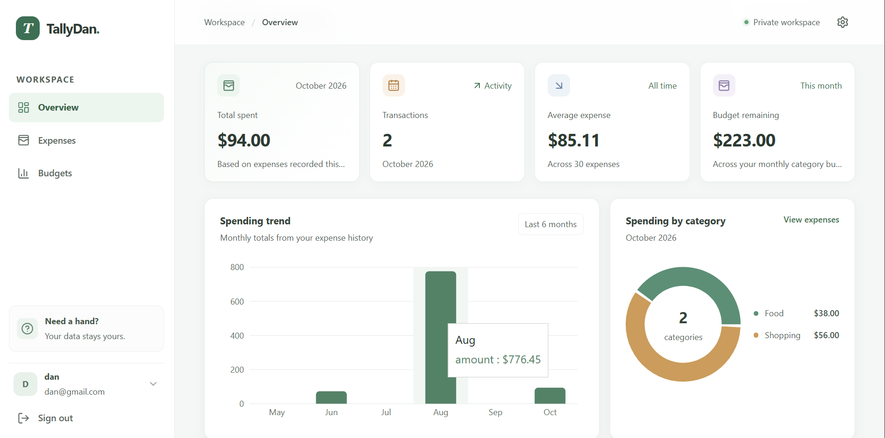
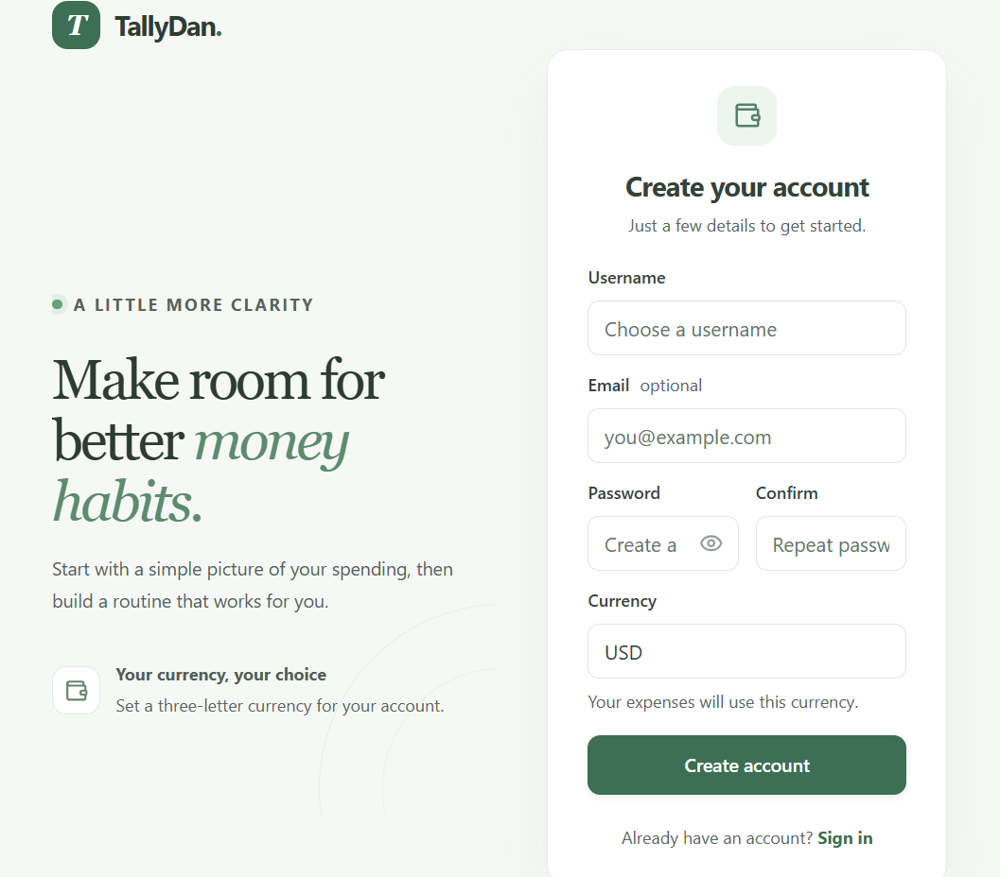
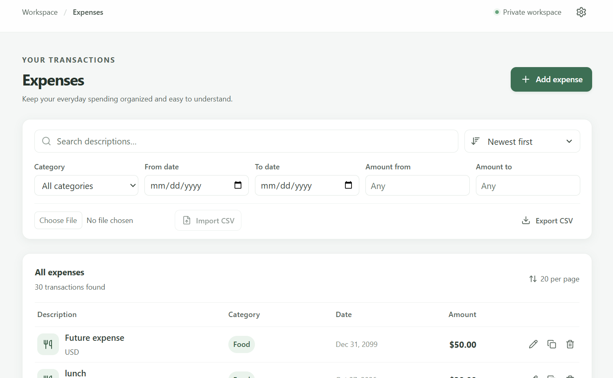

# TallyDan — Full-Stack Expense Tracker

TallyDan is a full-stack expense tracking and personal financial management application. It evolved from a local Python command-line project into a deployed web application.

The project is maintained across three branches in this repository:

- **`main`** — original Python CLI application.
- **`django-backend`** — Django REST Framework API.
- **`frontend`** — React frontend and full-stack application documentation.

## Live application

- **Web application:** https://tallydan-expense-tracker.vercel.app
- **Backend API:** https://expense-tracker-api-n5s7.onrender.com
- **Repository:** https://github.com/danielabdouroihamane9-gif/TallyDan

The frontend is deployed on Vercel and the backend is hosted on Render. The backend API is versioned under `/api/v1/`.

---

## Application preview

The screenshots below show the actual application interface.









> If an image does not render on GitHub, confirm that the corresponding image file has been committed and pushed to this branch at the exact path shown in the Markdown reference.

## Features

- User registration and sign-in.
- JWT-based access and refresh token authentication.
- Dashboard with monthly spending summaries and financial statistics.
- Expense creation, viewing, editing, deletion, filtering, and pagination.
- Category budgets and budget-versus-spending summaries.
- CSV import and export.
- Account profile and currency settings.
- Responsive interface for desktop and smaller screens.

## System architecture

TallyDan uses a decoupled client-server architecture:

```text
       User
        |
        v
+-------------------------+
| React + TypeScript      |
| Vite frontend           |
| Deployed on Vercel      |
+-------------------------+
        |
        | HTTPS / REST / JSON
        | JWT bearer token
        v
+-------------------------+
| Django REST Framework   |
| API hosted on Render    |
+-------------------------+
        |
        v
+-------------------------+
| PostgreSQL              |
| Production database     |
+-------------------------+
```

The frontend handles the user interface and API consumption. The backend is responsible for authentication, authorization, validation, application logic, and persistence.

## Technology stack

### Frontend

- React 19
- TypeScript
- Vite
- Tailwind CSS 4 and application CSS
- Axios
- TanStack Query
- React Router
- React Hook Form and Zod
- Recharts
- Radix UI and Lucide React

### Backend

- Python 3.13
- Django 5.2
- Django REST Framework
- SimpleJWT
- PostgreSQL in the deployed configuration; SQLite is available as the local default
- django-filter
- django-cors-headers
- Gunicorn and WhiteNoise
- Docker / Docker Compose

## API overview

The API base path is `/api/v1/`.

| Method | Endpoint | Purpose |
|---|---|---|
| POST | `/api/v1/auth/register/` | Register a user |
| POST | `/api/v1/auth/token/` | Obtain JWT access and refresh tokens |
| POST | `/api/v1/auth/token/refresh/` | Refresh an access token |
| GET | `/api/v1/auth/me/` | Retrieve the authenticated user's profile |
| GET / POST | `/api/v1/expenses/` | List or create the authenticated user's expenses |
| GET / PUT / PATCH / DELETE | `/api/v1/expenses/{uuid}/` | Retrieve, update, or delete an expense |
| GET | `/api/v1/expenses/summary/` | Retrieve monthly spending and budget summary |
| GET | `/api/v1/expenses/statistics/` | Retrieve expense statistics |
| GET / POST | `/api/v1/budgets/` | List or create category budgets |

See the [Django backend README](https://github.com/danielabdouroihamane9-gif/TallyDan/blob/django-backend/README.md) for the full endpoint reference, data model, setup, and backend tests.

## Local development

This repository uses separate branches for the CLI, backend, and frontend. The frontend branch contains the full-stack source tree.

### Frontend

1. Clone this branch:

```bash
git clone --branch frontend https://github.com/danielabdouroihamane9-gif/TallyDan.git
cd TallyDan/frontend
```

2. Install dependencies:

```bash
npm ci
```

3. Copy `.env.example` to `.env.local`. For local development, leave `VITE_API_BASE_URL` empty to use the Vite proxy.

4. Start the frontend:

```bash
npm run dev
```

### Backend

Start the Django API separately. Follow the [backend branch setup instructions](https://github.com/danielabdouroihamane9-gif/TallyDan/blob/django-backend/README.md). The default local API origin is `http://127.0.0.1:8000`.

## Testing

Frontend checks, run from `frontend/`:

```bash
npm run lint
npm test
npm run build
```

The Django backend has its own automated test suite and CI workflow. See the backend README for commands and coverage scope. Frontend unit tests and backend tests should not be represented as a complete end-to-end test of the deployed application.

## Deployment and CORS

- **Frontend hosting:** Vercel
- **Backend hosting:** Render
- **Production database:** PostgreSQL, configured through the backend environment.

The Django settings in this branch include `django-cors-headers`, `CorsMiddleware`, and the `CORS_ALLOWED_ORIGINS` environment setting. For production, the Render service must have `CORS_ALLOWED_ORIGINS` set to the exact deployed frontend origin, for example `https://tallydan-expense-tracker.vercel.app`. Do not use unrestricted CORS.

A local Vite proxy working correctly does not by itself prove that production CORS is configured. Verify the deployed frontend's preflight and authenticated API requests after backend deployment or environment changes.

## Project evolution

TallyDan grew through three practical stages:

1. **Python CLI:** local expense and budget workflows, JSON persistence, validation, and reporting.
2. **Django REST API:** relational data persistence, JWT authentication, user-scoped expense and budget resources, and financial summaries.
3. **Full-stack application:** a React frontend integrated with the Django API and deployed through Vercel and Render.

Explore the other stages:

- [Original Python CLI — `main`](https://github.com/danielabdouroihamane9-gif/TallyDan/tree/main)
- [Django REST API — `django-backend`](https://github.com/danielabdouroihamane9-gif/TallyDan/tree/django-backend)
- [Frontend source — `frontend`](https://github.com/danielabdouroihamane9-gif/TallyDan/tree/frontend)

This project demonstrates practical work in Python development, backend engineering, REST API design, relational data modeling, authentication, frontend integration, and application deployment. These software engineering foundations also support future work on data-driven and AI-enabled applications.

## License

See [LICENSE](LICENSE).
